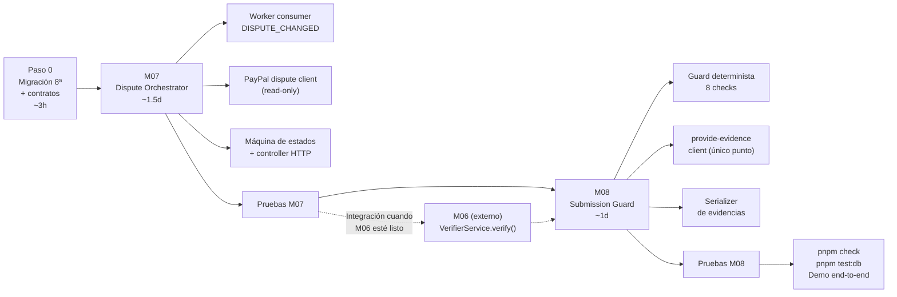

# Implementation Plan — M07 · M08

> **Deadline:** 2026-11-12, 14:00 CST  
> **Tiempo disponible:** ~5.5 días  
> **Stack fijo:** NestJS 11 · Prisma 7 · Zod · TypeScript ESM · PostgreSQL (Supabase)  
> **Restricción crítica:** la IA nunca tiene acceso directo a `provide-evidence`.
> Todo envío pasa por el guard determinista de M08.  
> **M06 (Verifier Agent):** implementado por otro miembro del equipo. Este plan
> asume que M06 expone `VerifierService.verify()` como interfaz pública y persiste
> `verdict` en la tabla `Investigation`. M07 se integra con esa interfaz.

---

## Visión general del flujo a implementar

```
WebhookEvent (DISPUTE_CHANGED)
    ↓  [M07 worker consume IngestionJob]
  Dispute (creada / actualizada)
    ↓  [M07 llama VerifierService de M06 — interfaz externa]
  VerificationResult { verdict: APPROVED | INCOMPLETE | REJECTED }
    ↓
  M07 evalúa veredicto
    ↓  APPROVED → AWAITING_MERCHANT_APPROVAL / READY_TO_SUBMIT
  M08 Submission Guard (verifica estado PayPal + permisos)
    ↓  SUBMITTED | BLOCKED | FAILED
  PayPal Disputes API
```

> **Orden de implementación: M07 → M08**
> M07 debe ir primero porque crea las tablas y el consumer de disputas del que
> depende M08. M07 integra M06 via su interfaz pública cuando esté disponible;
> hasta entonces usa un **stub interno** marcado como `// TODO: integrate M06`.

---

## Paso 0 — Migración 8ª: nuevas tablas (antes de cualquier módulo)

> **Duración estimada: 2–3 horas**  
> **Rama:** `feat/m07-dispute-orchestrator`

### 0.1 Nuevos modelos en `schema.prisma`

Añadir al final de `apps/api/prisma/schema.prisma`:

```prisma
// M07 — Dispute Orchestrator
// Estado interno ResolveAI; paypalStatus refleja la API de PayPal sin mezclar.
model Dispute {
  id                   String    @id @default(uuid()) @db.Uuid
  merchantId           String    @map("merchant_id") @db.Uuid
  transactionId        String?   @map("transaction_id") @db.Uuid
  dossierId            String?   @map("dossier_id") @db.Uuid
  paypalDisputeId      String    @map("paypal_dispute_id") @db.VarChar(255)
  environment          String    @default("sandbox")
  // Estado interno del workflow ResolveAI
  status               String    @default("DETECTED")
  // Estado y stage oficiales de PayPal (sólo se actualiza desde respuestas PayPal)
  paypalStatus         String?   @map("paypal_status") @db.VarChar(64)
  paypalStage          String?   @map("paypal_stage") @db.VarChar(64)
  // Razón de disputa devuelta por PayPal
  reason               String?   @db.VarChar(128)
  // Importe disputado
  disputedAmount       Decimal?  @map("disputed_amount") @db.Decimal(24, 8)
  disputedCurrencyCode String?   @map("disputed_currency_code") @db.VarChar(3)
  // Deadline para responder (devuelto por PayPal, en UTC)
  respondByDate        DateTime? @map("respond_by_date") @db.Timestamptz(3)
  // Acciones disponibles en PayPal al momento del último fetch
  paypalActions        Json?     @map("paypal_actions")
  // Payload del último fetch de PayPal (para trazabilidad)
  lastFetchedPayload   Json?     @map("last_fetched_payload")
  lastFetchedAt        DateTime? @map("last_fetched_at") @db.Timestamptz(3)
  // Aprobación del merchant para envío
  merchantApprovedAt   DateTime? @map("merchant_approved_at") @db.Timestamptz(3)
  merchantApprovedBy   String?   @map("merchant_approved_by") @db.Uuid
  // Referencia al WebhookEvent que originó el último cambio
  sourceEventId        String?   @map("source_event_id") @db.Uuid
  createdAt            DateTime  @default(now()) @map("created_at") @db.Timestamptz(3)
  updatedAt            DateTime  @updatedAt @map("updated_at") @db.Timestamptz(3)

  merchant      Merchant         @relation(fields: [merchantId], references: [id], onDelete: Restrict)
  transaction   Transaction?     @relation(fields: [transactionId, merchantId], references: [id, merchantId], onDelete: Restrict)
  dossier       EvidenceDossier? @relation(fields: [dossierId], references: [id], onDelete: Restrict)
  investigations Investigation[]
  submissions   Submission[]

  @@unique([merchantId, environment, paypalDisputeId])
  @@index([merchantId, status, createdAt])
  @@map("disputes")
}

// M06 (propietario externo) — Cada investigación corresponde a una ronda Investigator + Verifier.
// M07 escribe los campos de coordinación; M06 escribe verdict/verifierResult.
model Investigation {
  id               String       @id @default(uuid()) @db.Uuid
  disputeId        String       @map("dispute_id") @db.Uuid
  round            Int          @default(1)
  // Resultado del Investigator (OpenAI o MOCK)
  investigatorResult Json?      @map("investigator_result")
  investigatedAt   DateTime?    @map("investigated_at") @db.Timestamptz(3)
  // Resultado del Verifier
  verdict          String?      // APPROVED | INCOMPLETE | REJECTED
  verifierResult   Json?        @map("verifier_result")
  verifiedAt       DateTime?    @map("verified_at") @db.Timestamptz(3)
  // Evidencias verificadas
  verifiedEvidenceIds Json?     @map("verified_evidence_ids") // string[]
  missingRequirements Json?     @map("missing_requirements")  // string[]
  contradictions   Json?        // string[]
  reasons          Json?        // { code, explanation, evidenceIds[] }[]
  // Seguimiento de estado
  status           String       @default("PENDING") // PENDING | RUNNING | COMPLETED | FAILED
  errorCode        String?      @map("error_code") @db.VarChar(128)
  startedAt        DateTime?    @map("started_at") @db.Timestamptz(3)
  completedAt      DateTime?    @map("completed_at") @db.Timestamptz(3)
  createdAt        DateTime     @default(now()) @map("created_at") @db.Timestamptz(3)

  dispute   Dispute      @relation(fields: [disputeId], references: [id], onDelete: Restrict)
  submission Submission?

  @@index([disputeId, round])
  @@map("investigations")
}

// M08 — Submission Guard + PayPal
model Submission {
  id               String    @id @default(uuid()) @db.Uuid
  disputeId        String    @map("dispute_id") @db.Uuid
  investigationId  String?   @unique @map("investigation_id") @db.Uuid
  // Estado del envío
  status           String    // SUBMITTED | BLOCKED | FAILED
  blockedReason    String?   @map("blocked_reason") @db.VarChar(255)
  // Respuesta real de PayPal
  paypalRequestId  String?   @map("paypal_request_id") @db.VarChar(255)
  paypalHttpStatus Int?      @map("paypal_http_status")
  paypalDebugId    String?   @map("paypal_debug_id") @db.VarChar(128)
  paypalResponse   Json?     @map("paypal_response")
  // Autorización aplicada
  approvedByUserId String?   @map("approved_by_user_id") @db.Uuid
  submittedAt      DateTime? @map("submitted_at") @db.Timestamptz(3)
  createdAt        DateTime  @default(now()) @map("created_at") @db.Timestamptz(3)

  dispute       Dispute       @relation(fields: [disputeId], references: [id], onDelete: Restrict)
  investigation Investigation? @relation(fields: [investigationId], references: [id], onDelete: Restrict)

  @@index([disputeId, createdAt])
  @@map("submissions")
}
```

### 0.2 Relaciones que hay que añadir en modelos existentes

```prisma
// En model Merchant — añadir:
disputes  Dispute[]

// En model Transaction — añadir:
disputes  Dispute[]

// En model EvidenceDossier — añadir:
disputes  Dispute[]
```

### 0.3 Contratos nuevos en `packages/contracts`

Crear `packages/contracts/src/disputes.ts`:

```ts
import { z } from 'zod';

export const DisputeStatusSchema = z.enum([
  'DETECTED',
  'INVESTIGATING',
  'VERIFYING',
  'INCOMPLETE',
  'APPROVED',
  'AWAITING_MERCHANT_APPROVAL',
  'READY_TO_SUBMIT',
  'SUBMITTING',
  'SUBMITTED',
  'REJECTED',
  'NEEDS_REVIEW',
  'CLOSED',
]);
export type DisputeStatus = z.infer<typeof DisputeStatusSchema>;

export const VerificationVerdictSchema = z.enum([
  'APPROVED',
  'INCOMPLETE',
  'REJECTED',
]);

export const VerificationReasonSchema = z.object({
  code: z.string(),
  explanation: z.string(),
  evidenceIds: z.array(z.uuid()),
});

export const VerificationResultSchema = z.object({
  verdict: VerificationVerdictSchema,
  verifiedEvidenceIds: z.array(z.uuid()),
  missingRequirements: z.array(z.string()),
  contradictions: z.array(z.string()),
  reasons: z.array(VerificationReasonSchema),
});
export type VerificationResult = z.infer<typeof VerificationResultSchema>;

export const DisputeResponseSchema = z.object({
  id: z.uuid(),
  merchantId: z.uuid(),
  transactionId: z.uuid().nullable(),
  dossierId: z.uuid().nullable(),
  paypalDisputeId: z.string(),
  environment: z.literal('sandbox'),
  status: DisputeStatusSchema,
  paypalStatus: z.string().nullable(),
  paypalStage: z.string().nullable(),
  reason: z.string().nullable(),
  disputedAmount: z
    .object({ currencyCode: z.string(), value: z.string() })
    .nullable(),
  respondByDate: z.iso.datetime().nullable(),
  merchantApprovedAt: z.iso.datetime().nullable(),
  createdAt: z.iso.datetime(),
  updatedAt: z.iso.datetime(),
});
export type DisputeResponse = z.infer<typeof DisputeResponseSchema>;

export const DisputeQuerySchema = z.object({
  page: z.coerce.number().int().min(1).max(100000).default(1),
  pageSize: z.coerce.number().int().min(1).max(100).default(20),
  status: DisputeStatusSchema.optional(),
});

export const SubmissionResultSchema = z.object({
  id: z.uuid(),
  disputeId: z.uuid(),
  status: z.enum(['SUBMITTED', 'BLOCKED', 'FAILED']),
  blockedReason: z.string().nullable(),
  paypalRequestId: z.string().nullable(),
  paypalHttpStatus: z.number().int().nullable(),
  submittedAt: z.iso.datetime().nullable(),
  createdAt: z.iso.datetime(),
});
export type SubmissionResult = z.infer<typeof SubmissionResultSchema>;
```

Exportar desde `packages/contracts/src/index.ts`.

### 0.4 Comandos de migración

```bash
# Generar migración
pnpm --filter api prisma migrate dev --name add_disputes_investigations_submissions

# Verificar sin diferencias
pnpm --filter api prisma migrate dev --name check

# Regenerar cliente
pnpm --filter api prisma generate

# Correr suite completa
pnpm check
pnpm test:db
```

---

## Módulo M07 — Dispute Orchestrator

> **Duración estimada: 1–1.5 días**  
> **Carpeta:** `apps/api/src/modules/disputes/`  
> **Responsabilidad:** máquina de estados interna, consumer del outbox de disputa,
> vinculación con transacción/dossier, consulta de detalles a PayPal, rutas de listado/detalle/aprobación.

### Estructura de archivos

```
src/modules/disputes/
  disputes.module.ts
  disputes.service.ts          # Lógica de negocio y máquina de estados
  disputes.controller.ts       # GET /disputes, GET /disputes/:id, POST /disputes/:id/approve
  disputes.worker.ts           # Consume IngestionJob kind=DISPUTE_CHANGED
  paypal-dispute.client.ts     # GET /v1/customer/disputes/:id (READ-ONLY)
  dispute-linker.ts            # Vincula paypalDisputeId → Transaction → Dossier
  index.ts                     # Interfaz pública: DisputesService
```

### 7.1 `disputes.worker.ts` — Consumer del outbox

Reutiliza `IngestionQueueService.processNext('DISPUTE_CHANGED', ...)` igual que M03 usa `TRANSACTION_CAPTURED`. El worker:

1. Llama a `PayPalDisputeClient.fetch(paypalDisputeId)` para obtener el estado oficial actual.
2. Vincula la disputa a la `Transaction` por `paypalCaptureId` (desde el payload del webhook o desde la respuesta de PayPal).
3. Crea o actualiza el registro `Dispute` con `paypalStatus`, `paypalStage`, `reason`, `respondByDate` y `paypalActions`.
4. Avanza el estado interno con la máquina de estados de `disputes.service.ts`.

```ts
// disputes.worker.ts — esquema de lógica
async processNext(merchantId: string) {
  return this.queue.processNext('DISPUTE_CHANGED', merchantId, async (delivery, tx) => {
    const paypalDisputeId = extractDisputeId(delivery.payload); // desde webhook resource
    const paypalDetails  = await this.paypalClient.fetch(paypalDisputeId);
    const dispute        = await this.disputes.upsertFromPayPal(tx, {
      merchantId: delivery.merchantId,
      sourceEventId: delivery.eventId,
      paypalDisputeId,
      paypalDetails,
    });
    await this.disputes.advanceState(tx, dispute);
  });
}
```

### 7.2 `paypal-dispute.client.ts` — Lector de disputas

Solo operaciones de lectura; sin escritura:

```ts
// GET /v1/customer/disputes/:id
async fetch(paypalDisputeId: string): Promise<PayPalDisputeDetails>

// GET /v1/customer/disputes (listado con filtros)
async list(filters: { disputeState?: string }): Promise<PayPalDisputeDetails[]>
```

Reutiliza `PayPalAuthService.getAccessToken()` de M01 (ya exportado).  
Valida que el `paypalDisputeId` sea `PP-D-XXXXXXXX` antes de llamar.  
Acota la respuesta a 1 MiB (igual que `paypal-order-source.ts`).

### 7.3 `dispute-linker.ts` — Vinculación

```
paypalDisputeId
  → PayPal details.disputed_transactions[].buyer_transaction_id (= paypalCaptureId)
  → Transaction (WHERE paypalCaptureId = ?)
  → EvidenceDossier (WHERE transactionId = ?)
```

Si no existe la transacción → la disputa queda `DETECTED` sin `transactionId`.  
Si la vinculación crea un conflicto (p.ej. captura en otra cuenta) → `NEEDS_REVIEW`.

### 7.4 `disputes.service.ts` — Máquina de estados

| Estado actual                | Evento                                            | Estado siguiente               |
| ---------------------------- | ------------------------------------------------- | ------------------------------ |
| _(nuevo)_                    | `upsertFromPayPal`                                | `DETECTED`                     |
| `DETECTED`                   | Dossier vinculado + `allowInvestigations=true`    | `INVESTIGATING`                |
| `DETECTED`                   | Sin transacción vinculada                         | `NEEDS_REVIEW`                 |
| `INVESTIGATING`              | M06 (externo) retorna `INCOMPLETE` + rounds < MAX | `INCOMPLETE` → `INVESTIGATING` |
| `INVESTIGATING`              | M06 (externo) retorna `APPROVED`                  | `APPROVED`                     |
| `INVESTIGATING`              | M06 (externo) retorna `REJECTED`                  | `REJECTED`                     |
| `APPROVED`                   | `requireMerchantApproval=true`                    | `AWAITING_MERCHANT_APPROVAL`   |
| `APPROVED`                   | `requireMerchantApproval=false`                   | `READY_TO_SUBMIT`              |
| `AWAITING_MERCHANT_APPROVAL` | `POST /disputes/:id/approve`                      | `READY_TO_SUBMIT`              |
| `READY_TO_SUBMIT`            | M08 acepta                                        | `SUBMITTING` → `SUBMITTED`     |
| `READY_TO_SUBMIT`            | M08 bloquea                                       | `NEEDS_REVIEW`                 |
| `SUBMITTED`                  | Webhook `RESOLVED`                                | `CLOSED`                       |
| _(cualquiera)_               | Webhook `RESOLVED`                                | `CLOSED`                       |

> **Nunca** mezclar `status` (interno) con `paypalStatus` (oficial PayPal).

### 7.5 `disputes.controller.ts` — Rutas HTTP

| Método | Ruta                              | Auth         | Descripción                              |
| ------ | --------------------------------- | ------------ | ---------------------------------------- |
| `GET`  | `/api/disputes`                   | JWT + member | Listado paginado con filtro por `status` |
| `GET`  | `/api/disputes/:id`               | JWT + member | Detalle + última verificación            |
| `GET`  | `/api/disputes/:id/investigation` | JWT + member | Última ronda de investigación            |
| `GET`  | `/api/disputes/:id/verification`  | JWT + member | Veredicto, checklist y razones           |
| `POST` | `/api/disputes/:id/approve`       | JWT + ADMIN  | Registra aprobación del merchant         |
| `POST` | `/api/disputes/:id/investigate`   | JWT + ADMIN  | Encola o reactiva investigación          |
| `POST` | `/api/disputes/:id/submit`        | JWT + ADMIN  | Llama M08 Submission Guard               |

### 7.6 Pruebas M07

```
test/unit/dispute-linker.spec.ts       # Vinculación por captureId
test/unit/dispute-state-machine.spec.ts # Transiciones válidas e inválidas
test/http/disputes.spec.ts             # 401/403/404/200 con mock de PayPal
test/integration/disputes.db.spec.ts   # Consumer + upsert + estado en PostgreSQL real
```

---

## Módulo M08 — PayPal Submission Guard

> **Duración estimada: 1 día**  
> **Carpeta:** `apps/api/src/modules/submissions/`  
> **Responsabilidad:** validación determinista pre-envío, llamada a `provide-evidence`, registro del resultado real.  
> **Restricción:** la IA nunca llega a este módulo como caller. Solo M07 (via controller autenticado con aprobación) puede triggerar el envío.

### Estructura de archivos

```
src/modules/submissions/
  submissions.module.ts
  submissions.service.ts       # Guard + envío + registro
  paypal-submission.client.ts  # POST provide-evidence (el único lugar en el sistema)
  submission-guard.ts          # Validación determinista pre-envío
  evidence-serializer.ts       # Construye el payload de evidencia para PayPal
  index.ts                     # Interfaz pública: SubmissionsService
```

### 8.1 `submission-guard.ts` — Checks deterministas

Todos estos checks DEBEN pasar antes de llamar a PayPal. Si alguno falla → `BLOCKED`.

```ts
export interface GuardCheck {
  code: string;
  passed: boolean;
  reason?: string;
}

export async function runGuard(
  context: SubmissionContext,
): Promise<GuardResult> {
  const checks: GuardCheck[] = [
    // 1. Estado de la disputa en PayPal permite provide-evidence
    checkPayPalActionAvailable(context.paypalActions, 'PROVIDE_EVIDENCE'),

    // 2. La disputa está en estado READY_TO_SUBMIT (no NEEDS_REVIEW, no CLOSED)
    checkDisputeStatus(context.dispute.status, 'READY_TO_SUBMIT'),

    // 3. Existe una Investigation con veredicto APPROVED
    checkApprovedInvestigation(context.investigation),

    // 4. Merchant ha aprobado si requireMerchantApproval=true
    checkMerchantApproval(context.policy, context.dispute),

    // 5. No existe una Submission previa con status=SUBMITTED para esta disputa
    checkNoPriorSubmission(context.existingSubmissions),

    // 6. Evidencias no contienen sourceKind=DEMO
    checkNoDemo(context.verifiedEvidenceIds, context.dossierItems),

    // 7. Los IDs de captura y orden coinciden entre disputa y evidencias
    checkIdentityAlignment(context),

    // 8. Fecha límite de PayPal no ha expirado
    checkRespondByDate(context.dispute.respondByDate),
  ];

  const failed = checks.filter((c) => !c.passed);
  return {
    passed: failed.length === 0,
    checks,
    blockedReason: failed.map((c) => c.code).join('; ') || null,
  };
}
```

### 8.2 `paypal-submission.client.ts` — Único punto de envío

```ts
// POST /v1/customer/disputes/{id}/provide-evidence
// Solo se llama desde SubmissionsService.submit(), después del guard.
async provideEvidence(
  paypalDisputeId: string,
  payload: ProvideEvidencePayload,
  idempotencyKey: string,  // UUID único por intento de envío
): Promise<PayPalProvideEvidenceResponse>
```

Reutiliza `PayPalAuthService.getAccessToken()`.  
Guarda el `paypalRequestId` del header `PayPal-Request-Id` en la respuesta.  
Nunca reintenta automáticamente en caso de ambigüedad; si el resultado es ambiguo, registra `FAILED` y escala.

### 8.3 `evidence-serializer.ts` — Construcción del payload

Convierte `EvidenceItem[]` al formato que espera `provide-evidence`.

> **Verificar contra la API real antes de implementar:**  
> `POST /v1/customer/disputes/{id}/provide-evidence`  
> Documentación: https://developer.paypal.com/api/customer-disputes/v1/#disputes_provide-evidence

```ts
// Tipos de evidencia soportados por PayPal (verificar lista actual):
// PROOF_OF_FULFILLMENT, PROOF_OF_REFUND, PROOF_OF_DELIVERY_SIGNATURE_CONFIRMATION, etc.
export function serializeEvidence(
  items: EvidenceItem[],
  disputeReason: string,
): ProvideEvidencePayload {
  // Mapea types internos a types de PayPal
  // Solo incluye items con current=true y status!=CONFLICT
  // Ordena por relevancia al motivo de disputa
}
```

### 8.4 `submissions.service.ts` — Flujo completo

```ts
async submit(actor: MerchantActor, disputeId: string): Promise<SubmissionResult> {
  return this.prisma.$transaction(async (tx) => {
    // 1. Cargar disputa, investigación aprobada, dossier y política
    const context = await this.buildContext(tx, actor.merchantId, disputeId);

    // 2. Correr guard determinista
    const guard = await runGuard(context);

    // 3. Si guard falla → BLOCKED (nunca llama a PayPal)
    if (!guard.passed) {
      return tx.submission.create({
        data: {
          disputeId,
          investigationId: context.investigation?.id,
          status: 'BLOCKED',
          blockedReason: guard.blockedReason,
          approvedByUserId: actor.userId,
          submittedAt: null,
        },
      });
    }

    // 4. Serializar evidencias
    const payload = serializeEvidence(context.dossierItems, context.dispute.reason!);

    // 5. Llamar a PayPal (único lugar en todo el sistema)
    const idempotencyKey = randomUUID();
    let paypalResponse: PayPalProvideEvidenceResponse | null = null;
    let submissionStatus: 'SUBMITTED' | 'FAILED' = 'FAILED';
    try {
      paypalResponse = await this.paypalClient.provideEvidence(
        context.dispute.paypalDisputeId,
        payload,
        idempotencyKey,
      );
      submissionStatus = 'SUBMITTED';
    } catch (error) {
      // Log error; no relanzar sin registrar
    }

    // 6. Siempre registrar el resultado real (nunca simular éxito)
    const submission = await tx.submission.create({
      data: {
        disputeId,
        investigationId: context.investigation?.id,
        status: submissionStatus,
        paypalRequestId: idempotencyKey,
        paypalHttpStatus: paypalResponse?.httpStatus ?? null,
        paypalDebugId: paypalResponse?.debugId ?? null,
        paypalResponse: paypalResponse ?? undefined,
        approvedByUserId: actor.userId,
        submittedAt: submissionStatus === 'SUBMITTED' ? new Date() : null,
      },
    });

    // 7. Avanzar estado interno de la disputa
    await this.disputes.onSubmissionResult(tx, context.dispute, submissionStatus);

    return SubmissionResultSchema.parse(submission);
  }, { timeout: 30000 });
}
```

### 8.5 Pruebas M08

```
test/unit/submission-guard.spec.ts         # Cada check con fixtures
test/unit/evidence-serializer.spec.ts      # Mapeo de tipos internos → PayPal
test/http/submissions.spec.ts              # 401/403/409 y flujo BLOCKED con mock
test/integration/submissions.db.spec.ts   # Guard + registro de Submission en PostgreSQL real
```

**Casos obligatorios:**

- `[ ]` Estado PayPal no elegible → `BLOCKED`, sin llamada HTTP
- `[ ]` Sin aprobación merchant cuando se requiere → `BLOCKED`
- `[ ]` Evidencia DEMO → `BLOCKED`
- `[ ]` IDs no alineados → `BLOCKED`
- `[ ]` Envío exitoso → `SUBMITTED` con ID y código PayPal guardados
- `[ ]` Error HTTP de PayPal → `FAILED` con código real, sin `SUBMITTED` falso
- `[ ]` Segundo intento sobre mismo disputeId con `SUBMITTED` previo → `BLOCKED` por `checkNoPriorSubmission`

---

## Resumen del plan de trabajo



> [!NOTE]
> La línea punteada hacia M06 representa la integración con el equipo externo.
> M07 compila y funciona con un stub hasta que `VerifierService` esté disponible.

### Distribución de tiempo

| Día                | Actividad                                                       |
| ------------------ | --------------------------------------------------------------- |
| **Día 1 (mañana)** | Paso 0: schema + contratos + migración + `pnpm check`           |
| **Día 1 (tarde)**  | M07: worker + PayPal dispute client + linker                    |
| **Día 2 (mañana)** | M07: máquina de estados + controller HTTP                       |
| **Día 2 (tarde)**  | M07: pruebas + stub de M06 + coordinación con equipo M06        |
| **Día 3 (mañana)** | M08: guard determinista + serializer                            |
| **Día 3 (tarde)**  | M08: provide-evidence client + pruebas                          |
| **Día 4 (mañana)** | Integración M07 ↔ M06 real (si disponible) + ajuste de pruebas  |
| **Día 4 (tarde)**  | Buffer: fixtures de demo, casos exitoso y bloqueado             |
| **Día 5**          | `pnpm check` final, despliegue en Render, validación end-to-end |

---

## Reglas de implementación (recordatorio)

1. **Nunca simular un resultado de PayPal exitoso.** Si el HTTP falla, registrar `FAILED`.
2. **El único lugar que llama a `provide-evidence` es `paypal-submission.client.ts`.** Ningún otro archivo puede importar esa función.
3. **M07 integra M06 via interfaz pública `VerifierService`.** Hasta que M06 esté listo, usar un stub interno marcado `// TODO: integrate M06` que retorne `INCOMPLETE` por defecto (comportamiento seguro: no avanza a READY_TO_SUBMIT sin verificación real).
4. **Evidencias con `sourceKind=DEMO` nunca pasan el guard de M08.** El check es determinista.
5. **Correr `pnpm check` tras cada archivo.** Si cambia un contrato de `packages/contracts`, actualizar todos los consumidores antes de hacer PR.
6. **Las pruebas usan mocks de PayPal identificados (`PAYPAL_ENV=mock`).** Las pruebas `test:db` usan PostgreSQL real desechable.
7. **Documentar en `docs/` cada decisión de API PayPal no obvia** (payload de `provide-evidence`, acciones disponibles por estado, etc.).
8. **PRs pequeños:** uno por módulo, con sus pruebas. No mezclar M07 + M08 en un solo PR.
9. **Coordinar con el equipo de M06** el contrato de `VerifierService` (firma, tipos, errores esperados) antes de que M07 integre la interfaz real. El contrato propuesto está en `packages/contracts/src/disputes.ts` (`VerificationResultSchema`).
