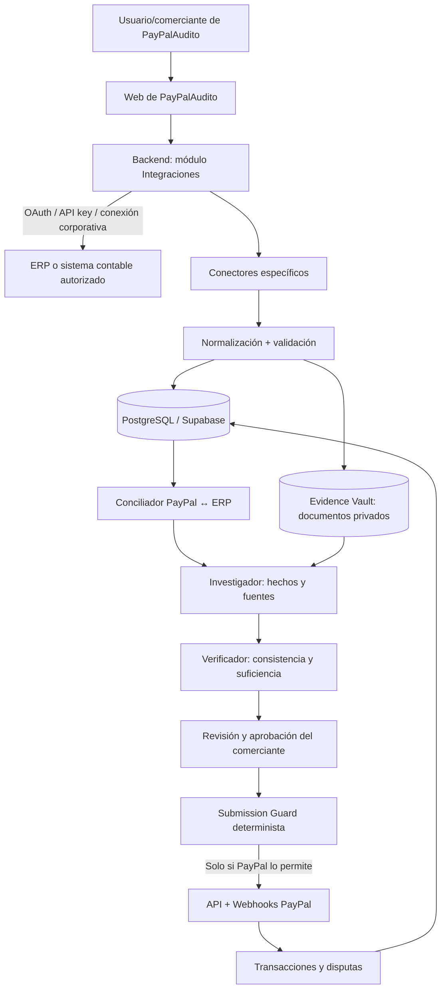

# PayPalAudito — Guía de integración con ERP y sistemas contables

> **Tipo:** documento de arquitectura funcional y técnica · **Estado:** propuesta, no implementación terminada  
> **Actualizado:** 10 de noviembre de 2026  
> **Objetivo:** permitir que cada comercio conecte voluntariamente su ERP, sincronizar sus registros autorizados y utilizar evidencia verificable para investigar y responder reclamaciones relacionadas con pagos PayPal.

## 1. Resumen ejecutivo

PayPalAudito será un sistema que reúne información **de PayPal** y **del ERP de un comercio** para crear expedientes de operaciones, detectar discrepancias y reunir documentos que ayuden a responder disputas. La conexión debe realizarse **por empresa**: un usuario registrado en PayPalAudito selecciona su proveedor, autoriza el acceso por OAuth o proporciona credenciales técnicas de integración, y nuestro backend consulta los datos permitidos.

**No todos los ERP admiten “Iniciar sesión y conectar”**. Existen cuatro patrones:

1. **OAuth 2.0 con consentimiento del usuario:** el proveedor muestra su propia pantalla de autorización. Ej.: QuickBooks Online, Xero, Zoho Books; Business Central y NetSuite con configuración/permisos adicionales.
2. **Clave API o token generado dentro del ERP:** el usuario copia la clave en PayPalAudito. Ej.: Bind ERP, Odoo JSON-2 y ERPNext.
3. **Instancia de empresa y alta administrativa:** el administrador registra una aplicación, habilita servicios y asigna roles. Ej.: SAP Business One, SAP S/4HANA, Infor, Oracle Fusion y algunos entornos de Dynamics.
4. **SDK o conector instalado localmente:** el ERP funciona en un equipo o servidor del cliente y no ofrece una API SaaS genérica. Ej.: determinadas instalaciones de CONTPAQi y Aspel SAE.

**Alcance útil para las disputas:** pedido original, factura/recibo, líneas de productos, importe, fecha, moneda, información mínima de cliente, estado de pago, cancelación/devolución, envío, transportista y número de seguimiento, si existen. **Una factura no demuestra por sí sola que se entregó un pedido:** es necesario distinguir venta, despacho y entrega efectivamente acreditada.

> **Advertencia sobre popularidad:** los proveedores se agrupan por segmentos donde suelen comercializarse; esta guía **no** presenta una clasificación estadística definitiva de cuota de mercado ni afirma que un ERP sea el más utilizado en México sin una encuesta comparable.

---

## 2. Relación entre PayPalAudito, PayPal y el ERP



**Responsabilidades separadas:**

- **PayPal** es la fuente autoritativa del ID del pago/captura, de la disputa, su estado y las acciones permitidas.
- **ERP** es una fuente de registro empresarial: pedido, venta, factura, inventario, notas de crédito y/o pagos registrados.
- **Transportista o tienda** suele ser la fuente principal de seguimiento, entrega y prueba de recepción; un ERP puede tener parte de esta información, pero no se debe asumir.
- **PayPalAudito** cruza registros, conserva procedencia y propone evidencia. No inventa pruebas, no garantiza ganar una disputa y no debe enviar nada automáticamente sin permiso y validaciones.

**Regla de acceso:** tener autorización para consultar un ERP no da autorización a leer la cuenta PayPal de la empresa; son conexiones distintas.

---

## 3. Matriz rápida de integraciones

| Plataforma | Segmento típico | Tipo de integración | Experiencia de conexión | Datos potencialmente útiles | Prioridad sugerida |
|---|---|---|---|---|---|
| **Bind ERP** | Pequeña / mediana, México | REST + API Key | Copiar API Key en configuración | Clientes, productos, documentos comerciales según endpoint | **P0** |
| **Siigo Nube México** | Pequeña, México | REST + `username`/`access_key` para token | Generar credenciales API | Facturas, clientes, productos, recepciones de pago | **P0** |
| **Odoo** | Pequeña / mediana | JSON-2 (v19+) + API Key; otros métodos heredados | URL de instancia + API Key | Pedidos, facturas, contactos, stock | **P0/P1** |
| **ERPNext (Frappe)** | Pequeña / mediana | REST + token; opciones OAuth según instancia | URL de instancia + clave/secret | Sales Order, Sales Invoice, Customer, Delivery Note | **P1** |
| **Zoho Books** (contabilidad) | Pequeña / mediana | REST + OAuth 2.0 | Conectar cuenta Zoho y seleccionar organización | Invoices, customers, sales orders, pagos | **P1** |
| **CONTPAQi** | Pequeña / mediana, México | SDK de escritorio / APIs según producto nube | Configuración local o alta del producto | Facturación y datos comerciales según producto | **P2: piloto** |
| **Aspel SAE escritorio** | Pequeña / mediana, México | Integración según versión/implantación | Conector especial; no asumir REST pública universal | Ventas, clientes y facturas si se habilita | **P2: investigación** |
| **Dynamics 365 Business Central** | Mediana | REST API v2.0/OData + OAuth Entra | OAuth y posible consentimiento de administrador | Sales invoices, orders, customers | **P1** |
| **Oracle NetSuite** | Mediana / grande | SuiteTalk REST + OAuth 2.0 | Registro de integración + autorización | Transacciones, órdenes, clientes, facturas | **P1/P2** |
| **SAP Business One** | Mediana | Service Layer OData v4 | URL de instancia + sesión/configuración | Invoices, Orders, BusinessPartners | **P2** |
| **Acumatica** | Mediana | REST/OData + OAuth 2.0 | Registrar app en instancia + autorización | Pedidos, facturas, embarques | **P2** |
| **Sage Intacct** | Mediana | REST + licencia de Web Services | Alta del acceso técnico y permisos | AR invoices, clientes y registros financieros | **P2** |
| **SAP S/4HANA** | Grande | APIs OData/REST por proceso | Escenario de comunicación de TI | Órdenes, facturación, socios comerciales | **P3** |
| **Oracle Fusion Cloud ERP** | Grande | REST de Oracle Financials/ERP | Identidad corporativa + privilegios | Facturas, cuentas por cobrar y operaciones | **P3** |
| **Dynamics 365 Finance & Operations** | Grande | OData + OAuth Entra | App registrada + acceso a entidades | Facturas, clientes, órdenes y finanzas | **P3** |
| **Infor CloudSuite / LN / M3** | Grande | ION API Gateway + OAuth 2.0 | Authorized App/archivo de configuración | Datos según API suite y tenant | **P3** |
| **Workday** | Grande; enfoque finanzas/RR. HH. | REST/Integrations + OAuth | Registro y configuración corporativa | Datos financieros donde estén expuestos | **P3** |
| **QuickBooks Online** (contabilidad) | Pequeña / mediana, internacional | REST + OAuth 2.0 | Botón «Conectar QuickBooks» | Facturas, clientes, pagos y transacciones | **P1 internacional** |
| **Xero** (contabilidad) | Pequeña / mediana, internacional | REST + OAuth 2.0 | Botón «Conectar Xero» y elegir organización | Invoices, contacts, payments | **P1 internacional** |

**Importante:** no todos los productos de la tabla son ERP completos: **Zoho Books, QuickBooks Online y Xero** se incluyen por su utilidad como fuentes contables. «Datos potencialmente útiles» no significa que todos estén disponibles en cualquier plan, licencia, región o tenant. P0–P3 son **prioridades propuestas** para PayPalAudito, no una valoración oficial.

---

## 4. Cómo conectar cada plataforma

### 4.1. Bind ERP (México) — P0

- **Descripción:** ERP para pymes, con gestión comercial e información empresarial.
- **API oficial:** <https://developers.bind.com.mx/tutorials>
- **URL base documentada:** `https://api.bind.com.mx`.
- **Autenticación:** encabezado `Authorization: Bearer <API_KEY_DEL_COMERCIO>`; **no es OAuth de consentimiento**.
- **Pasos del comercio:** ingresar a Bind → Perfil de usuario → Integraciones → generar API Key → copiarla una sola vez en el formulario seguro de PayPalAudito.
- **Pasos de PayPalAudito:** recibir clave **solo en backend**, cifrarla, efectuar una consulta mínima de verificación, asociar la conexión a la empresa, identificar recursos permitidos e iniciar sincronización incremental.
- **Límites documentados para usuarios sin suscripción de desarrollador:** hasta **150 solicitudes/5 min** y **5,000/24 h**. Con suscripción registrada se documentan **300/5 min** y **10,000/24 h**; en ese caso, además de la clave del comercio, debe enviarse `Ocp-Apim-Subscription-Key`.
- **Precaución:** la API Key tiene amplios privilegios; usarla únicamente en el servidor, restringir permisos donde el producto lo permita y contemplar su rotación.

Ejemplo ilustrativo de **consulta de catálogo**, no de generación de factura:

```http
GET https://api.bind.com.mx/api/Products
Authorization: Bearer <API_KEY_DEL_COMERCIO>
Accept: application/json
```

Los endpoints para facturas, órdenes y movimientos deben confirmarse en el catálogo correspondiente antes de codificar el adaptador.

### 4.2. Siigo Nube México — P0

- **Descripción:** sistema de facturación y administración para empresas mexicanas.
- **Documentación específica de México:** <https://developers.siigo.com/docs/siigoapimexico>.
- **Autenticación:** la empresa genera `username` y `access_key` en **Alianzas → Mi Credencial API**. Con ellas se llama a `POST https://api.siigo.mx/auth` para obtener un `access_token` tipo Bearer.
- **Vigencia del token según documentación:** aproximadamente **24 horas** (`expires_in: 86400`); la aplicación debe renovarlo de forma controlada.
- **Recursos documentados en México:** `/customers`, `/products`, `/invoices`, `/vouchers` (recepciones de pago).
- **Cómo integrarlo:** formulario seguro para las credenciales API → emisión de token en backend → prueba de consulta → almacenar credenciales cifradas y fecha de caducidad → sincronizar facturas, recepciones y clientes.
- **Atención:** **Siigo API Colombia y Siigo API México no son la misma API**; usan bases y algunos recursos diferentes. La documentación mexicana incluye el encabezado `SiigoAPI-Application-Id` para identificar la aplicación.

Documentación de generación de token: <https://developers.siigo.com/docs/siigoapimexico/auth/generate-token>.

### 4.3. Odoo — P0/P1

- **Descripción:** plataforma modular de ventas, inventario, facturación, CRM y contabilidad.
- **API moderna:** JSON-2, introducida en **Odoo 19**; patrón `POST https://<instancia>/json/2/<modelo>/<método>`, cabecera `Authorization: bearer <API_KEY>`.
- **Documentación:** <https://www.odoo.com/documentation/19.0/developer/reference/external_api.html>.
- **Cómo conectarlo:** pedir URL de instancia, base de datos si aplica al entorno, usuario técnico/autorizado y API Key; verificar versión, modelos, permisos y recursos instalados.
- **Modelos útiles para evaluar:** `sale.order`, `account.move`, `res.partner`, `stock.picking`, de acuerdo con módulos y reglas del cliente.
- **Restricción de licenciamiento:** el acceso a la API externa de **Odoo Online** está incluido en el plan **Custom**, no en One App Free/Standard. Las condiciones de despliegues propios pueden variar.
- **Legado:** XML-RPC/JSON-RPC externos están en retirada; no construir un conector nuevo exclusivamente sobre esas interfaces si podemos usar JSON-2.
- **Riesgo técnico:** campos y métodos pueden variar según versión, módulos y personalizaciones; descubrir capacidades por instancia.

### 4.4. ERPNext / Frappe — P1

- **Descripción:** ERP abierto basado en Frappe, con documentos de ventas, compras, facturación y entregas.
- **API:** `https://<instancia>/api/resource/<DocType>` (REST de Frappe).
- **Autenticación por token:** `Authorization: token <API_KEY>:<API_SECRET>`; el administrador puede generar las claves para un usuario de integración con roles limitados.
- **Documentación:** <https://docs.frappe.io/framework/user/en/guides/integration/rest_api> y <https://docs.frappe.io/framework/user/en/guides/integration/rest_api/token_based_authentication>.
- **Cómo conectarlo:** URL de instancia HTTPS → usuario de servicio con permisos mínimos → clave y secreto → consulta de prueba → lecturas de `Sales Order`, `Sales Invoice`, `Delivery Note`, `Customer` si esos DocTypes están autorizados.
- **Consideración:** no extrapolar permisos entre distintos sitios Frappe; validar los roles de cada instancia. Algunas instalaciones pueden implementar OAuth, pero el flujo deberá comprobarse para ese tenant.

### 4.5. Zoho Books — P1

- **Descripción:** herramienta contable del ecosistema Zoho; no la confundimos con todo el conjunto de aplicaciones Zoho.
- **API y OAuth:** <https://www.zoho.com/books/api/v3/oauth/> (consultar versión vigente de la API de cada cuenta).
- **Cómo conectarlo:** registrar una aplicación **Server-based** → configurar redirect URI de PayPalAudito → enviar al usuario a autorización Zoho con scopes de **solo lectura** adecuados → recibir `code` → canjear tokens del lado servidor → obtener/seleccionar `organization_id` → leer facturas, contactos y pedidos permitidos.
- **Importante:** Zoho utiliza dominios regionales. Guardar región/API domain y no asumir que todas las empresas usan el mismo dominio.

### 4.6. CONTPAQi — P2 / investigación por producto

- **Descripción:** ecosistema mexicano con productos distintos de escritorio y nube.
- **Fuente oficial de SDK:** <https://contenidos.contpaqi.com/generales> y <https://contenidos.contpaqi.com/premium>.
- **Cómo conectarlo:** primero preguntar **producto, versión y despliegue**. Para **Comercial Premium** de escritorio, revisar SDK oficial y diseñar, si procede, un **agente/conector local** instalado con autorización de la empresa; ese agente consulta el SDK y transmite por HTTPS únicamente los datos autorizados a PayPalAudito. Para servicios en la nube, investigar la API **específica de ese producto**, no asumir una API única para todo CONTPAQi.
- **No hacer:** exponer bases locales o puertos del ERP a Internet ni leer tablas de producción directamente sin soporte/contrato técnico.
- **Estado:** integración condicionada a piloto con cliente real, licencias y documentación del SDK.

### 4.7. Aspel SAE de escritorio — P2 / investigación

- **Descripción:** administración comercial, inventario, ventas y cuentas por cobrar.
- **Cómo conectarlo:** identificar versión instalada, arquitectura y mecanismos permitidos por fabricante/distribuidor. Evaluar conector autorizado, exportaciones estructuradas o integración específica; **no se ha verificado una API REST pública universal** equivalente a Bind para cualquier instalación de SAE.
- **Estado:** **no prometer un botón de conexión automática** hasta completar una prueba técnica y contractual.

### 4.8. Microsoft Dynamics 365 Business Central — P1

- **Descripción:** ERP cloud/on-prem de pymes y medianas empresas, especialmente en el ecosistema Microsoft.
- **API:** REST/OData **v2.0** y Connect Apps: <https://learn.microsoft.com/en-us/dynamics365/business-central/dev-itpro/api-reference/v2.0/>.
- **Autenticación de producción:** Microsoft Entra ID / OAuth 2.0. La empresa puede necesitar consentimiento de administrador y permisos de Business Central.
- **Cómo conectarlo:** registrar aplicación Entra → definir permisos apropiados → implementar autorización y callback seguros → descubrir tenant, environment y company id → consultar entidades de facturas de venta, pedidos y clientes → almacenar tokens cifrados.
- **Precaución:** en Business Central SaaS la autenticación básica antigua fue retirada; no diseñar soluciones nuevas con contraseña de usuario como método de producción.

### 4.9. Oracle NetSuite — P1/P2

- **Descripción:** ERP cloud para empresas medianas y grandes.
- **API:** SuiteTalk REST Web Services; dominio **propio de la cuenta** (`<account>.suitetalk.api.netsuite.com`).
- **OAuth:** soporta **Authorization Code Grant**, con consentimiento del usuario y refresh token, pero el administrador debe crear un **Integration Record** y configurar roles/permisos.
- **Cómo conectarlo:** registrar integración en la cuenta NetSuite → configurar Client ID/secret y callback → autorizar al usuario/rol → obtener el dominio específico → verificar acceso a registros relevantes (invoices, sales orders, customers) → sincronizar con paginación.
- **Referencias:** <https://docs.oracle.com/en/cloud/saas/netsuite/ns-online-help/section_158074210415.html> y <https://docs.oracle.com/en/cloud/saas/netsuite/ns-online-help/section_1546938065.html>.

### 4.10. SAP Business One — P2

- **Descripción:** ERP de gestión comercial/financiera para pymes y medianas empresas.
- **API:** **Service Layer**; OData v4 bajo `/b1s/v2` (OData v3 `/b1s/v1` es heredado).
- **Autenticación:** Service Layer tradicionalmente maneja **sesión/cookies**; requiere URL de instancia, empresa y usuario técnico/autorizado. No es un OAuth multiempresa universal listo para conectar.
- **Cómo conectarlo:** configurar Service Layer con el equipo de TI del cliente → proporcionar conectividad segura (red privada/VPN/proxy autorizado) → autenticarse → consultar objetos como Orders, Invoices y BusinessPartners → mantener control de sesión → limitar consultas.
- **Referencias:** <https://help.sap.com/docs/SAP_BUSINESS_ONE/f110a154dd0f4c20bf7f3ebca9eeb794/60c7a0b745bd486589f05a1da77041f3.html> y <https://help.sap.com/doc/056f69366b5345a386bb8149f1700c19/10.0/en-US/Service%20Layer%20API%20Reference.html>.

### 4.11. Acumatica — P2

- **Descripción:** ERP cloud/instancia empresarial con módulos de ventas y finanzas.
- **API:** REST/OData; OAuth 2.0 para aplicaciones conectadas.
- **Cómo conectarlo:** el administrador registra PayPalAudito en **Connected Applications (SM303010)** → configura OAuth y redirección → el usuario autoriza → PayPalAudito consume la API específica de esa instancia y versión → mapea facturas y ventas.
- **Referencias:** <https://beacon.acumatica.com/r/Integration-Development-Guide/Authorizing-Client-Applications-to-Work-with-Acumatica-ERP/Getting-Started-with-OAuth-2.0-and-OpenID-Connect-Authorization/OAuth-2.0-and-OIDC-Working-with-Data-in-Acumatica-ERP> y <https://help-2025r1.acumatica.com/%28W%281%29%29/Wiki/ShowWiki.aspx?PageID=ff95236f-4221-49f7-8cec-9471458f261b&wikiname=HelpRoot_Dev_Integration>.

### 4.12. Sage Intacct — P2

- **Descripción:** gestión financiera para empresas medianas.
- **API:** REST; acceso sujeto a **licencia de Web Services**.
- **Cómo conectarlo:** confirmar licencia vigente y autorización del cliente → completar registro de integración según el procedimiento del portal Sage → asignar roles/permisos → verificar conectividad y recursos de facturas/cobros disponibles → sincronizar.
- **Referencia:** <https://developer.sage.com/intacct>.
- **Limitación:** no ofrecer vinculación de un clic sin validar requisitos de licencia y alta técnica.

### 4.13. SAP S/4HANA — P3

- **Descripción:** ERP corporativo con procesos financieros, ventas, compras y cadena de suministro.
- **APIs:** endpoints por **objeto/proceso** publicados en SAP Business Accelerator Hub; en S/4HANA Cloud pueden necesitarse *communication scenarios/arrangements* configurados.
- **Cómo conectarlo:** equipo TI configura comunicación, permisos y entorno → selecciona APIs relevantes (p. ej., Sales Order y Billing Document, según edición) → PayPalAudito se autentica con el mecanismo permitido → ingiere solo los objetos habilitados.
- **Referencia:** <https://api.sap.com/package/SAPS4HANACloud>.
- **Limitación:** S/4HANA Public Cloud, Private Cloud y on-premise no son intercambiables; confirmar edición y versión.

### 4.14. Oracle Fusion Cloud ERP / Financials — P3

- **Descripción:** ERP corporativo, con API para cuentas por cobrar, facturas y otros recursos financieros.
- **API:** REST de Oracle Fusion Cloud Financials; p. ej., familias de recursos de **Receivables Invoices**.
- **Cómo conectarlo:** obtener URL de instancia, identidad técnica aprobada y roles → autorizar mediante el mecanismo de identidad configurado para esa empresa → realizar prueba de lectura → mapear identificadores y documentos.
- **Referencia:** <https://docs.oracle.com/en/cloud/saas/financials/26a/api.html> y <https://docs.oracle.com/en/cloud/saas/financials/26d/farfa/api-receivables-invoices.html>.

### 4.15. Microsoft Dynamics 365 Finance & Operations — P3

- **Descripción:** ERP empresarial de finanzas y operaciones.
- **API:** servicios OData y servicios REST personalizados; soportan OAuth 2.0 con Microsoft Entra (authorization code y escenarios service-to-service).
- **Cómo conectarlo:** registrar aplicación Entra → habilitar acceso a la instancia y entidades en Dynamics → verificar derechos y entorno → sincronizar entidades relevantes y revisar posibles extensiones.
- **Referencia:** <https://learn.microsoft.com/en-us/dynamics365/fin-ops-core/dev-itpro/data-entities/services-home-page>.

### 4.16. Infor CloudSuite / LN / M3 — P3

- **Descripción:** soluciones empresariales por industria.
- **API:** **Infor ION API Gateway**, con OAuth 2.0 y aplicaciones autorizadas.
- **Cómo conectarlo:** TI crea **Authorized App**, selecciona scopes y obtiene credenciales (en algunos casos archivo `.ionapi`) → PayPalAudito registra el tenant y un secreto cifrado → consulta las API suites expuestas a esa empresa.
- **Referencias:** <https://docs.infor.com/ln/2026.x/en-us/lnesolh/lnrestapiag/yqw1698244624331.html> y <https://docs.infor.com/inforos/2024.x/en-us/useradminlib_cloud/apigatewayag_cloud/lpa1489500371574.html>.

### 4.17. Workday — P3

- **Descripción:** plataforma empresarial ampliamente orientada a finanzas y recursos humanos.
- **API:** Workday REST / integraciones, con mecanismos OAuth y permisos del tenant.
- **Cómo conectarlo:** administrador registra cliente y habilita endpoints del tenant → configurar scopes/roles y autorización → determinar si los datos financieros **necesarios para disputas de ventas** están presentes en ese Workday → implementar adaptador específico.
- **Referencias:** <https://developer.workday.com/documentation/GUID-86d66a6b-5d1a-40e4-af1b-ba4859f5df5a-enHYPHENus/WorkdayRESTAPIs> y <https://developer.workday.com/documentation/axg1518029552225>.
- **Prioridad baja:** no asumir que Workday sea el repositorio de pedidos e-commerce o seguimiento de paquetería.

### 4.18. QuickBooks Online — P1 internacional

- **Descripción:** sistema contable, no ERP universal, muy útil para facturas y pagos.
- **API:** QuickBooks Online Accounting API + OAuth 2.0.
- **Cómo conectarlo:** registrar app de Intuit → botón «Conectar QuickBooks» → redirigir a consentimiento → recibir `code` y **`realmId`** → canjear tokens y registrar empresa (`realmId`) → consultar recursos con `realmId` y scopes autorizados.
- **Referencia:** <https://developer.intuit.com/app/developer/qbo/docs/develop/authentication-and-authorization/oauth-2.0>.
- **Precaución:** conciliación de pagos PayPal y registros contables puede requerir un identificador intermedio; el solo importe no prueba correspondencia.

### 4.19. Xero — P1 internacional

- **Descripción:** contabilidad cloud para pymes.
- **API:** REST + OAuth 2.0, organizaciones/tenants.
- **Cómo conectarlo:** registrar app Xero → autorización del usuario → intercambiar `code` por tokens → consultar conexiones autorizadas y seleccionar `tenantId` → leer datos mediante cabecera de tenant cuando aplique.
- **Restricción comercial:** el plan de desarrollador **Starter** documenta un límite de **5 conexiones organizacionales**; verificar las condiciones vigentes antes de ofrecerlo a escala.
- **Referencia:** <https://developer.xero.com/documentation/guides/oauth2/overview>.

---

## 5. Flujo de vinculación de cuentas en PayPalAudito

### 5.1. Registro del comercio

1. Usuario crea su cuenta en PayPalAudito y su organización/`merchant_id`.
2. Acepta condiciones y permisos de tratamiento de datos; se registra quién autorizó qué integración.
3. Conecta **PayPal por separado**, si está habilitado para su caso de uso; confirmar mecanismo de autorización de terceros/partner para producción y no asumir que el `client_id` del backend da acceso a cualquier merchant.
4. En **Configuración → Integraciones → ERP**, selecciona el proveedor.
5. PayPalAudito muestra únicamente los campos necesarios para ese ERP y su variante de despliegue.
6. El backend verifica conexión, identidad del tenant y capacidades; informa si hay permisos faltantes.
7. Usuario autoriza la primera sincronización; se muestra estado y fecha de última sincronización.
8. Puede pausar, reconectar, rotar credenciales y desconectar.

### 5.2. OAuth 2.0 (caso de botón «Conectar ERP»)

```mermaid
sequenceDiagram
    participant U as Comercio
    participant W as Frontend
    participant B as Backend PayPalAudito
    participant E as ERP OAuth
    U->>W: Conectar ERP
    W->>B: POST /integrations/{provider}/start
    B->>B: Generar state + PKCE; asociar a merchant
    B-->>W: URL de autorización del proveedor
    W->>E: Redirección a login/consentimiento
    E-->>B: GET /integrations/{provider}/callback?code=...&state=...
    B->>B: Validar state, expiración y merchant
    B->>E: Intercambiar code por tokens (servidor)
    E-->>B: Tokens y vencimiento
    B->>B: Cifrar tokens, identificar tenant y scopes
    B-->>W: Conexión pendiente de verificación o conectada
    B->>E: Consulta mínima permitida
    B->>B: Registrar capacidades y programar sincronización
```

**Seguridad obligatoria:** `state` resistente a CSRF, PKCE cuando el proveedor lo soporta, redirect URI registrado, token exchange en backend, refresh con bloqueo de concurrencia, cifrado y revocación, sin tokens en la URL final del navegador.

### 5.3. API Key o credenciales API (Bind, Siigo, ERPNext, Odoo)

```text
Formulario HTTPS → API de PayPalAudito → cifrado secreto → prueba de lectura
→ guardar conexión del merchant → sincronización por worker → auditoría
```

- Nunca almacenar secretos en `localStorage` ni enviarlos a un modelo de IA.
- Restringir URL introducidas por el cliente mediante validación estricta de dominios/hosts para evitar SSRF, redirects a IP privadas o acceso a metadatos cloud. Si se requieren direcciones privadas, usar **conector local** o red corporativa aprobada.
- Validar la pertenencia de la cuenta externa al comercio antes de marcarla activa.

### 5.4. Instalaciones locales o corporativas (CONTPAQi, Aspel, algunos SAP)

**Patrón recomendado de agente local (si SDK/licencia lo permite):**

```text
[ERP en red privada] → [Conector firmado e instalado por TI]
→ HTTPS saliente con credencial limitada → [PayPalAudito API]
→ normalización y evidencia
```

El conector nunca debe abrir una base de datos local directamente al Internet público. Debe registrar versión, integridad, estado y permisos, ofrecer actualización y posibilidad de desactivación por el cliente.

---

## 6. Arquitectura propuesta dentro del sistema

**Compatibilidad con un stack TypeScript existente:** frontend Next.js/React, backend **NestJS modular** (sin microservicios obligatorios), PostgreSQL/Supabase y Prisma, archivos en Supabase Storage privado, trabajos asíncronos con `pg-boss` si ya está elegido. Ajustar nombres de carpetas al repositorio real; **no asumir que los módulos ya están implementados**.

```text
apps/
  web/
    app/(dashboard)/settings/integrations/  # catálogo, conectar, estado, desconectar
  api/src/modules/
    merchants/                              # ownership, roles, credenciales del comercio
    integrations/
      controllers/                          # start, callback, key-connect, status
      adapters/
        bind.adapter.ts
        siigo-mx.adapter.ts
        odoo.adapter.ts
        erpnext.adapter.ts
        business-central.adapter.ts
        netsuite.adapter.ts
        quickbooks.adapter.ts
        xero.adapter.ts
      interfaces/                           # contratos normalizados
      auth/                                 # OAuth y almacenamiento de secretos
      sync/                                 # incremental, paginación, reintentos
    transactions/                           # relación captura PayPal ↔ venta ERP
    evidence/                               # pruebas, metadatos, hash, archivo privado
    investigator/                           # solicita hechos, nunca secretos
    verifier/                               # marca inconsistencias, ausencia de pruebas
    disputes/                               # estado real de PayPal
    submissions/                            # Submission Guard + aprobación humana
packages/contracts/                         # Zod + tipos compartidos
prisma/                                      # modelos/migraciones
```

### 6.1. Contrato único de conectores

```ts
// Ejemplo de INTERFAZ PROPUESTA, no código ya implementado.
export type ErpCapability =
  | 'customers'
  | 'sales_orders'
  | 'invoices'
  | 'payments'
  | 'refunds'
  | 'shipments'
  | 'documents';

export interface ErpConnector {
  provider: string;
  verifyConnection(connectionId: string): Promise<{
    externalTenantId: string;
    capabilities: ErpCapability[];
  }>;
  pullSalesOrders(connectionId: string, cursor?: string): Promise<SyncPage>;
  pullInvoices(connectionId: string, cursor?: string): Promise<SyncPage>;
  pullPayments?(connectionId: string, cursor?: string): Promise<SyncPage>;
  pullShipments?(connectionId: string, cursor?: string): Promise<SyncPage>;
  disconnect(connectionId: string): Promise<void>;
}

export interface SyncPage {
  records: unknown[];  // Validar y mapear con Zod según proveedor.
  nextCursor?: string;
  sourceUpdatedAt?: string;
}
```

Cada adaptador implementa: autenticación, fetch, límites, paginación, conversión de campos, errores, reintentos y pruebas; el resto del producto solo consume **objetos normalizados**, no formatos particulares de SAP u Odoo.

### 6.2. Tablas recomendadas

| Tabla | Campos esenciales | Consideración |
|---|---|---|
| `merchants` | `id`, `name`, `owner_user_id` | Identidad interna de empresa |
| `erp_connections` | `id`, `merchant_id`, `provider`, `external_tenant_id`, `base_url`, `status`, `scopes`, `last_sync_at` | Una empresa puede tener varias conexiones |
| `erp_secrets` | `connection_id`, `encrypted_payload`, `key_version`, `rotated_at` | Acceso backend restringido; alternativa: vault gestionado |
| `erp_sync_cursors` | `connection_id`, `resource`, `cursor`, `last_success_at` | Sincronización incremental |
| `external_records` | `merchant_id`, `connection_id`, `record_type`, `external_id`, `updated_at`, `normalized_payload`, `source_hash` | `UNIQUE(connection_id, record_type, external_id)` |
| `transaction_links` | `merchant_id`, `paypal_capture_id`, `paypal_order_id`, `record_id`, `match_method`, `confidence`, `reviewed_by` | Conciliación trazable |
| `evidence_items` | `merchant_id`, `dispute_id`, `source`, `source_record_id`, `storage_path`, `sha256`, `collected_at`, `verification_status` | Prueba con cadena de procedencia |
| `integration_audit_events` | `merchant_id`, `connection_id`, `actor_id`, `action`, `status`, `occurred_at` | No guardar tokens, PII excesiva o documentos en logs |

**Aislamiento:** cada consulta interna debe estar limitada por `merchant_id` y permisos del usuario; las políticas RLS de Supabase (si se aplican) y los guards del backend deben implementarse y probarse. No usar el campo `merchant_id` recibido del cliente sin validar ownership.

### 6.3. Endpoints internos sugeridos

```http
GET    /api/integrations/catalog
GET    /api/integrations
POST   /api/integrations/{provider}/start
GET    /api/integrations/{provider}/callback
POST   /api/integrations/{provider}/connect-with-key
GET    /api/integrations/{connectionId}/status
POST   /api/integrations/{connectionId}/sync
POST   /api/integrations/{connectionId}/disconnect
GET    /api/transactions/{captureId}/linked-records
GET    /api/disputes/{disputeId}/evidence-sources
```

Estas rutas son **diseño interno propuesto**, **no** endpoints de los proveedores de ERP.

---

## 7. Conciliación de registros de ERP con PayPal

La parte crítica no es «leer una factura», sino probar **qué documento pertenece a qué transacción disputada**.

### 7.1. Identificadores a conservar

| Origen | Identificador | Uso |
|---|---|---|
| PayPal | `capture_id` | Pago capturado; principal punto de unión al expediente |
| PayPal | `order_id` | Orden PayPal asociada |
| PayPal | `invoice_id` | Número externo facilitado durante el checkout, si el comercio lo envió |
| PayPal | `custom_id` | Referencia externa útil para conciliación, si el comercio la envió |
| ERP | `external_order_id` | Pedido ERP |
| ERP | `invoice_number`, `external_invoice_id` | Factura y folio |
| ERP | `external_payment_id` | Cobro registrado, no necesariamente la captura PayPal |
| Logística | `tracking_number`, `carrier` | Seguimiento, por sí solo no acredita entrega |

Los campos `invoice_id` y `custom_id` de PayPal **pueden estar ausentes** en ventas históricas o integraciones donde el comercio no los proporcionó. Documentación oficial: <https://developer.paypal.com/api/orders/v2/definitions/purchase_unit>.

### 7.2. Algoritmo de correspondencia propuesto

1. **Vinculación exacta:** coincidencia explícita por `invoice_id`, `custom_id`, o mapeo persistido del sistema de checkout.
2. **Corroboración:** mismo comercio, importe compatible, moneda, fecha y estado; comprobar pagos parciales, impuestos, descuentos y costos de envío.
3. **Coincidencia sugerida:** si no hay referencia exacta, mostrar candidatos para **revisión humana**, nunca declararlos prueba concluyente.
4. **Conflicto:** dos pedidos con mismo importe/fecha o un importe diferente → `needs_review`; no unir automáticamente.
5. **Expediente:** guardar evidencia del criterio usado, IDs originales y fechas; no sobrescribir el registro fuente sin versionarlo.

**No usar solo email, nombre del comprador o monto** como clave de unión. Pueden repetirse y producir falsos positivos. Si el ERP indica «factura pagada», no inferir «pago recibido por PayPal» sin registro de enlace.

### 7.3. Ejemplo de expediente normalizado (datos ficticios)

```json
{
  "merchantId": "merchant_demo_01",
  "paypal": {
    "captureId": "CAPTURE_DEMO_001",
    "orderId": "ORDER_DEMO_001",
    "invoiceId": "FAC-2026-00124",
    "amount": "1299.00",
    "currency": "MXN"
  },
  "erp": {
    "provider": "bind",
    "sourceRecordId": "ERP_INVOICE_DEMO_124",
    "invoiceNumber": "FAC-2026-00124",
    "amount": "1299.00",
    "currency": "MXN",
    "documentAvailability": "pending_verification"
  },
  "reconciliation": {
    "method": "invoice_id_exact",
    "status": "matched_with_checks",
    "verifiedDocument": false
  },
  "shipment": {
    "trackingNumber": null,
    "deliveryProven": false
  },
  "demo": true
}
```

**Ejemplo/fixture**: no es una factura real ni prueba que se entregó el producto.

---

## 8. Datos de ERP convertidos en evidencia útil para reclamos

| Situación | Registro a buscar | Qué respalda | Qué NO demuestra automáticamente |
|---|---|---|---|
| Producto no recibido (INR) | Pedido + factura + guía + confirmación del transportista | Venta, preparación, envío y eventualmente entrega | Una factura por sí sola no prueba recepción |
| Producto distinto de lo anunciado | Descripción/SKU en pedido, factura, catálogo histórico y comunicaciones | Qué se vendió y qué se ofrecía | Estado real del producto sin prueba adicional |
| Cargo no reconocido | Pedido, registro de checkout, historial de cumplimiento | Contexto de la compra | Identidad/autorización real del pagador por sí solo |
| Reembolso reclamado | Nota de crédito, devolución y **reembolso PayPal real** | Gestión de devolución y fondos, si ambas fuentes coinciden | Una nota de crédito no prueba reembolso de PayPal |
| Entrega tardía o no efectuada | Orden y fecha prometida, despacho, tracking | Cronología del cumplimiento | Aceptación del comprador sin confirmación |

**Requisito:** leer la disputa real de PayPal y consultar `reason`, `evidences.evidence_type`, `evidences.source`, `seller_response_due_date`, `status`, `allowed_response_options`. La documentación de PayPal describe `POST /v1/customer/disputes/{id}/provide-evidence`, pero **solo** corresponde enviar cuando el estado y la API lo permiten, con acceso y autorizaciones suficientes. Fuentes: <https://developer.paypal.com/platforms/disputes/handle-disputes/use-disputes-api/> y <https://developer.paypal.com/disputes/reasons-evidence/>.

Flujo de auditoría de evidencia:

```text
ERP/tienda/transportista → registro original (con ID y fecha)
→ descarga/autenticidad comprobada → hash SHA-256
→ almacenamiento privado con referencia y versión
→ Investigator produce afirmaciones vinculadas a fuentes
→ Verifier revisa faltantes/contradicciones
→ comerciante aprueba → Submission Guard verifica estado de PayPal
→ envío, si está permitido → guardar respuesta y auditoría
```

Si el ERP solo expone metadatos y no PDF/XML, mostrar `documento_no_disponible`; no fabricar un comprobante «oficial» desde un JSON y presentarlo como original.

---

## 9. Seguridad, privacidad y operación

### 9.1. Controles mínimos

- **Consentimiento informado** del comerciante, propósitos específicos, identificación de la organización vinculada y posibilidad de revocación.
- **Permisos mínimos de lectura**; ningún conector debe crear facturas, mover inventario, pagar, reembolsar o borrar registros en el MVP.
- **Cifrado de credenciales** con KMS/Vault o esquema de cifrado en backend con rotación de llave, jamás en frontend ni en logs.
- **Token refresh** y expiración; detectar `invalid_grant`, clave revocada, `401`, `403` y mostrar estado de reconexión.
- **Validación contra SSRF** en URLs personalizadas, protección contra redirects, rate limiting e IP allowlisting/controles de red cuando el ERP lo exija.
- **Aislamiento de tenant** por `merchant_id`, autorización de rol del usuario y auditoría.
- **Protección de PII:** almacenar únicamente campos necesarios; cifrar documentos, delimitar retención, aplicar políticas de acceso, borrado/desvinculación y legislación aplicable (incluida normativa mexicana de datos personales cuando corresponda).
- **Verificación de webhooks** PayPal y de ERP cuando exista; idempotencia por event ID.
- **Observabilidad:** métricas por proveedor, errores, paginación, latencia, solicitudes fallidas, límite 429 y costos.
- **IA sin secretos:** Investigator/Verifier reciben objetos autorizados, minimizados y referencias a documentos; jamás token/API key ni acceso libre a la red.

### 9.2. Sincronización

- Primera sincronización acotada por fechas y tamaño, previa aprobación del comercio.
- Incrementales por `updated_at`, cursor o token de cambio, cuando el ERP lo soporte; si no, ventana limitada con deduplicación.
- Webhooks validados donde el proveedor los ofrezca; **no asumir** que todos los ERP tienen eventos.
- Reintentar errores temporales con backoff exponencial y jitter; respetar `Retry-After` si aparece.
- Prohibir duplicados usando `connection_id + resource_type + external_id`.
- Guardar `last_success`, `next_cursor`, última excepción técnica sanitizada y estado visible al comerciante.
- Al desvincular, revocar donde sea posible; detener jobs; aplicar política de retención/borrado a datos y evidencias sin incumplir obligaciones legítimas de conservación.

### 9.3. Estados de conexión visibles en UI

`pending_authorization`, `connected`, `syncing`, `restricted_permissions`, `needs_reauth`, `rate_limited`, `error`, `disconnected`.

---

## 10. Plan de implementación recomendado

### Fase 0 — Contratos y demo segura

- Catálogo de proveedores con distinción OAuth / API Key / agente local.
- Modelo de datos, interfaz `ErpConnector`, migraciones, ownership de merchants.
- Un **MockERP** explícitamente etiquetado `DEMO / MOCK` para pruebas de disputas sin credenciales.
- Caso E2E de conciliación por `invoice_id` con datos ficticios, evidencia vinculada y Verifier bloqueando documentos no demostrados.

### Fase 1 — México: dos conectores reales

1. **Bind ERP:** API Key + verificar lectura + facturas/pedidos según recursos efectivamente disponibles + límites.
2. **Siigo Nube México:** credencial API + token 24 h + lectura `/invoices`, `/customers`, `/vouchers`.
3. Recolección de documentos solo cuando el endpoint real devuelva un PDF/XML válido.
4. Pruebas contra sandbox/test accounts o cuentas de clientes **con autorización explícita**.

### Fase 2 — Ampliación pyme y OAuth

- **Odoo** (JSON-2, revisar plan y versión), **ERPNext** (Frappe REST).
- **Business Central** para OAuth empresarial.
- Si se busca mercado global: **QuickBooks Online**, **Xero**, **Zoho Books**.

### Fase 3 — ERP medianos/corporativos

- **NetSuite, SAP Business One, Acumatica, Sage Intacct**.
- Pilotos condicionados a un cliente patrocinador para **CONTPAQi y Aspel**.
- Después **SAP S/4HANA, Oracle Fusion, Dynamics Finance, Infor, Workday**.

### Criterios de aceptación por conector

- [ ] Método de autorización documentado y probado.
- [ ] La cuenta externa corresponde al merchant correcto.
- [ ] Credenciales cifradas; secretos ausentes de navegador, logs y repositorio.
- [ ] Lectura real de un recurso permitido.
- [ ] Paginación, errores 401/403/429, timeouts y reconexión tratados.
- [ ] Sincronización incremental o alternativa acotada reproducible.
- [ ] ID externo, fechas, moneda y procedencia conservados.
- [ ] Conciliación exacta y caso ambiguo cubiertos por pruebas.
- [ ] Evidencia sin documentos falsos ni promesas de entrega no comprobada.
- [ ] Desconectar detiene acceso y jobs.
- [ ] No se hacen escrituras al ERP ni se presenta evidencia a PayPal sin autorización expresa.

---

## 11. Primeras tareas de desarrollo para el equipo o agente de código

1. Revisar la **estructura real** de PayPalAudito y sus esquemas antes de crear módulos o modificar tablas. No presuponer que el stack, rutas o integraciones aquí descritos ya existen.
2. Diseñar `ErpConnector` + validadores Zod + pruebas de contrato.
3. Agregar `erp_connections`, `erp_sync_cursors`, `external_records`, `transaction_links` y almacenamiento seguro de secretos.
4. Implementar endpoints internos con verificación de ownership/roles y registro de auditoría.
5. Implementar **Bind ERP** detrás de una feature flag; construir fixtures señalizados y tests de error.
6. Implementar **Siigo Nube México** y renovación de token; utilizar documentación mexicana.
7. Programar sincronización (pg-boss o solución ya presente) con backoff e idempotencia.
8. Conectar registros normalizados con PayPal `capture_id`, `invoice_id` y `custom_id`; crear UI para **coincidencia no segura**.
9. Integrar expediente de evidencia con fuente original, hash, timestamp y controles de privacidad.
10. Ejecutar tests unitarios, integración y E2E con escenarios positivos/negativos; registrar qué endpoints reales funcionaron y cuáles siguen simulados.

### Prompt sugerido para un asistente de programación

> Lee `PayPalAudito_Integraciones_ERP.md` y revisa primero el repositorio real, sus convenciones y contratos. Diseña la implementación mínima del módulo de integraciones ERP sin refactorizar módulos ajenos. Empieza por Bind ERP en modo lectura, propone modelos Prisma, validadores Zod, control de permisos por `merchant_id`, almacenamiento cifrado de claves y pruebas. Antes de escribir llamadas externas, verifica en la documentación oficial los endpoints y su disponibilidad. No simules datos reales ni envíes evidencia a PayPal. Entrega cambios pequeños y especifica qué se probó y qué quedó pendiente.

---

## 12. Alternativa: APIs unificadas de contabilidad

Se puede evaluar **Codat** (<https://docs-integration.codat.io/integrations/accounting/overview/>) y **Merge** (<https://docs.merge.dev/merge-unified/concepts>) para unificar ciertos conectores contables. Revisar cobertura real por región, plan, objetos necesarios, precio y permisos. **No asumir** que incluyen Bind, Siigo México, CONTPAQi o Aspel sin confirmación contractual y prueba de API. Para una propuesta centrada en comercios mexicanos, sigue siendo razonable construir Bind/Siigo directamente.

---

## 13. Fuentes oficiales y notas de verificación

Documentos consultados o contrastados al **10 de noviembre de 2026**. La documentación puede cambiar; antes de publicar cada conector, confirmar versión, autenticación y términos.

- **PayPal — Disputas, estados y evidencia:** <https://developer.paypal.com/platforms/disputes/handle-disputes/use-disputes-api/>.
- **PayPal — Tipos de disputa y prueba:** <https://developer.paypal.com/disputes/reasons-evidence/>.
- **PayPal — IDs externos de Orders v2:** <https://developer.paypal.com/api/orders/v2/definitions/purchase_unit>.
- **Bind ERP — Guía de API/clave/límites:** <https://developers.bind.com.mx/tutorials>.
- **Siigo Nube México — Recursos:** <https://developers.siigo.com/docs/siigoapimexico>.
- **Siigo Nube México — Generar token:** <https://developers.siigo.com/docs/siigoapimexico/auth/generate-token>.
- **Odoo — JSON-2:** <https://www.odoo.com/documentation/19.0/developer/reference/external_api.html>.
- **Odoo — Deprecación RPC externa:** <https://www.odoo.com/documentation/19.0/developer/reference/external_rpc_api.html>.
- **ERPNext / Frappe REST:** <https://docs.frappe.io/framework/user/en/guides/integration/rest_api>.
- **ERPNext / Frappe token:** <https://docs.frappe.io/framework/user/en/guides/integration/rest_api/token_based_authentication>.
- **Zoho Books — OAuth:** <https://www.zoho.com/books/api/v3/oauth/>.
- **CONTPAQi — SDK:** <https://contenidos.contpaqi.com/generales>.
- **Business Central — API v2.0:** <https://learn.microsoft.com/en-us/dynamics365/business-central/dev-itpro/api-reference/v2.0/>.
- **NetSuite — OAuth code flow:** <https://docs.oracle.com/en/cloud/saas/netsuite/ns-online-help/section_158074210415.html>.
- **NetSuite — Account-specific URLs:** <https://docs.oracle.com/en/cloud/saas/netsuite/ns-online-help/section_1546938065.html>.
- **SAP Business One — Service Layer:** <https://help.sap.com/doc/056f69366b5345a386bb8149f1700c19/10.0/en-US/Service%20Layer%20API%20Reference.html>.
- **Acumatica — OAuth/REST:** <https://beacon.acumatica.com/r/Integration-Development-Guide/Authorizing-Client-Applications-to-Work-with-Acumatica-ERP/Getting-Started-with-OAuth-2.0-and-OpenID-Connect-Authorization/OAuth-2.0-and-OIDC-Working-with-Data-in-Acumatica-ERP>.
- **Sage Intacct — licencia API:** <https://developer.sage.com/intacct>.
- **SAP S/4HANA — API Hub:** <https://api.sap.com/package/SAPS4HANACloud>.
- **Oracle Fusion Financials — APIs:** <https://docs.oracle.com/en/cloud/saas/financials/26a/api.html>.
- **Dynamics Finance & Operations — servicios:** <https://learn.microsoft.com/en-us/dynamics365/fin-ops-core/dev-itpro/data-entities/services-home-page>.
- **Infor — API Gateway auth:** <https://docs.infor.com/ln/2026.x/en-us/lnesolh/lnrestapiag/yqw1698244624331.html>.
- **Workday — REST:** <https://developer.workday.com/documentation/GUID-86d66a6b-5d1a-40e4-af1b-ba4859f5df5a-enHYPHENus/WorkdayRESTAPIs>.
- **QuickBooks Online — OAuth:** <https://developer.intuit.com/app/developer/qbo/docs/develop/authentication-and-authorization/oauth-2.0>.
- **Xero — OAuth y límites:** <https://developer.xero.com/documentation/guides/oauth2/overview>.

**Conclusión:** el éxito de PayPalAudito no depende de integrar todos los ERP al mismo tiempo, sino de conectar primero unos cuantos **con datos auténticos, seguridad multiempresa y correspondencias comprobables con PayPal**. Para México, comenzar por **Bind ERP + Siigo Nube México**; después ampliar a **Odoo/ERPNext** y **Business Central**, y priorizar el resto cuando exista demanda de clientes concretos.
